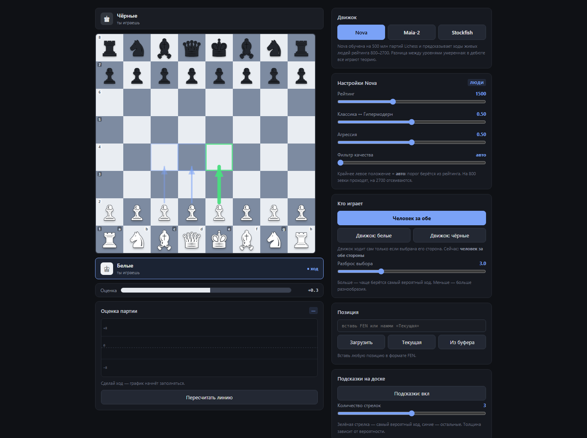
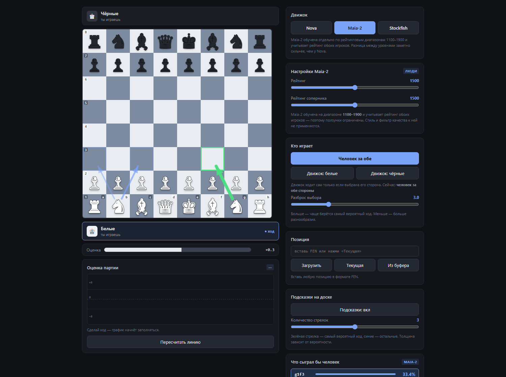
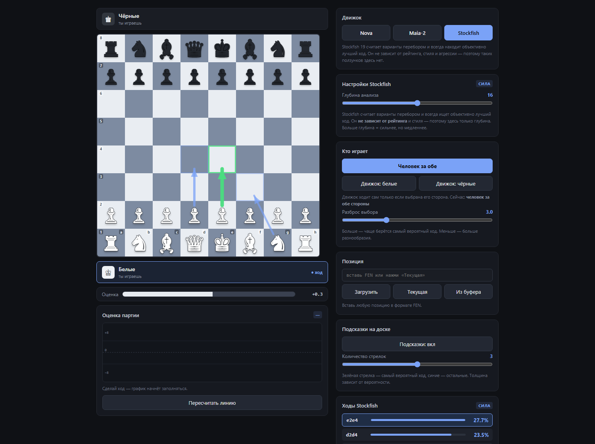

# Nova Chess

**Шахматный анализатор с тремя движками: два имитируют человека, третий считает истину.**

[](https://github.com/n1lokaDeep/nova-chess/actions/workflows/tests.yml)
[]()
[]()



Каждый движок получает **свою панель настроек** — лишних ползунков не показывается.

| Nova | Maia-2 | Stockfish |
|---|---|---|
|  |  |  |
| рейтинг, стиль, агрессия, фильтр | два рейтинга, без стиля и фильтра | только глубина |

Движок можно открыть ссылкой: `#nova`, `#maia`, `#sf`.

---

## ⚠️ Прочитайте перед использованием

Проект рабочий, но у каждого движка есть особенности, о которых лучше знать заранее.

### Nova — не рекомендуется как основной движок

Nova обучена на 500 млн партий Lichess и предсказывает человеческие ходы.
Однако в **открытом релизе отсутствует калибровочный слой**. Авторы модели
прямо пишут об этом в своём README:

> Per-tier temperature scheduling — the primary calibration lever…
> The calibration layer is not part of this release.

Что это значит на практике:

- **Разница между 800 и 2700 слабая.** В дебюте уровни почти не отличаются:
  все играют теорию, и модель это честно отражает.
- **Проценты различаются на единицы**, а не в разы.
- Разумнее всего Nova ведёт себя в верхнем диапазоне (2000–2700).

**Вывод:** Nova интересна как исследовательский инструмент и как способ
посмотреть, как распределяются ходы людей. Для достоверной имитации
конкретного уровня игры она подходит хуже, чем Maia-2.

### Maia-2 — заметно медленная

Maia-2 держит **две нейросетевые головы** (policy + value head), поэтому
каждый ход стоит **2–4 секунды** против 0.03–0.15 с у Nova.

| Движок | Время на ход |
|---|---|
| Nova | 30–170 мс |
| Stockfish | 0.3–1 с |
| **Maia-2** | **2–4 с** |

**Вывод:** Maia-2 удобна для анализа и разбора, но для игры в реальном
времени (тем более блица) она тяжеловата. Её плюс в другом: она обучалась
отдельно по рейтинговым диапазонам, поэтому в теории различает уровни
чётче. **На практике это зависит от позиции** — на одних позициях сильнее
меняется Nova, на других Maia-2. Готового рецепта «кто лучше имитирует
уровень» нет, обе модели стоит сравнить на своих позициях
(см. `examples/compare_engines.py`).

### Maia-2 ограничена диапазоном 1100–1900

Вне этих границ модель не обучена. Ползунок рейтинга автоматически
ограничивается при выборе Maia-2. Для рейтингов выше 1900 остаётся Nova.

### Stockfish не имитирует человека

Он считает варианты перебором и всегда находит объективно лучший ход.
Рейтинг, стиль и агрессия на него **не влияют** — таких настроек у него нет
по определению. Это не баг, а назначение.

### Ещё несколько честных замечаний

| Замечание | Подробность |
|---|---|
| **Модели не в репозитории** | Nova весит 381 МБ, её нужно скачать отдельно |
| **Оценка требует Stockfish** | без него график партии и полоса оценки не работают |
| **Фильтр замедляет ход** | каждый кандидат оценивается Stockfish, ~0.1 с на позицию |
| **CI проверяет не всё** | в облаке нет модели и Stockfish, поэтому эти тесты пропускаются — на них стоит `skipif` |
| **Есть известные неточности** | см. раздел «Ограничения» в конце — там полный список |

---

## Что это

Три движка в одном интерфейсе:

| Движок | Что делает | Диапазон |
|---|---|---|
| **Nova** | предсказывает ходы людей | 800–2700 |
| **Maia-2** | предсказывает ходы людей, учитывает обоих игроков | 1100–1900 |
| **Stockfish** | ищет объективно лучший ход | любой |

Фильтр качества отсеивает ходы, которые человек бы сделал, но которые стоят
материала. График оценки показывает, как менялся перевес по ходу партии.

---

## Возможности

| Функция | Описание |
|---|---|
| 🎭 **Три движка** | переключение на лету, у каждого своя панель настроек |
| 📊 **Настройка рейтинга** | отдельная модель поведения для каждого уровня |
| 🎨 **Две оси стиля** | классика ↔ гипермодернизм, спокойствие ↔ агрессия |
| 🛡️ **Фильтр качества** | Stockfish отсеивает ходы, теряющие больше N сантипешек |
| 🎚️ **Калибровка по рейтингу** | порог фильтра выводится из рейтинга автоматически |
| 📈 **График оценки партии** | линия перевеса по полуходам, с пересчётом |
| ♟️ **Стрелки подсказок** | от 1 до 5 ходов прямо на доске, толщина = вероятность |
| ✨ **Плавная анимация** | фигуры переезжают, а не телепортируются |
| 📋 **Загрузка позиции** | вставка FEN, копирование текущей, вставка из буфера |
| ♟️ **CLI** | команды `moves`, `play`, `compare`, `selfplay` |
| ✅ **80 тестов** | кодирование, движки, фильтр, гибрид, перспектива, проверка позиций |

---

## Установка

```bash
git clone https://github.com/n1lokaDeep/nova-chess.git
cd nova-chess
pip install -r requirements.txt
```

### Модели

**Nova** (381 МБ) — скачайте с Hugging Face:

```bash
curl -L -o models/nova_v3b.onnx \
  https://huggingface.co/novachess/novachess-engine/resolve/main/nova_v3b.onnx

curl -L -o models/nova_v3b.onnx.data \
  https://huggingface.co/novachess/novachess-engine/resolve/main/nova_v3b.onnx.data
```

**Stockfish** — с [stockfishchess.org/download](https://stockfishchess.org/download/),
путь укажите в переменной окружения:

```bash
export NOVA_STOCKFISH_PATH=/path/to/stockfish
```

**Maia-2** — ставится одним пакетом, веса подтянутся сами:

```bash
pip install maia2
```

---

## Использование

### Веб-интерфейс

```bash
python -m nova_chess.web.server
```

Откроется `http://127.0.0.1:8765/`.

### CLI

```bash
# Какие ходы сделал бы человек рейтинга 1500?
python -m nova_chess.cli moves --rating 1500 --top 5

# Один ход движка с фильтром качества
python -m nova_chess.cli play --rating 1800 --strictness 0.7

# Сравнить чистую Nova и фильтрованную
python -m nova_chess.cli compare --stockfish /path/to/stockfish

# Партия Nova против Nova
python -m nova_chess.cli selfplay --moves 40 --rating 2000
```

Пример вывода:

```
$ python -m nova_chess.cli moves --rating 1500 --top 4
Позиция: rnbqkbnr/pppppppp/8/8/8/8/PPPPPPPP/RNBQKBNR w KQkq - 0 1
Ход белые
Рейтинг: 1500   Стиль: 0.50   Агрессия: 0.50

Ход         Nova   Stockfish   Оценка
----------------------------------------------
e2e4       56.0%         +32   лучший
d2d4       23.9%         +20   потеря 12 сп
c2c4        5.1%          +9   потеря 23 сп
g1f3        3.6%         +21   потеря 11 сп
```

### Python API

```python
import chess
from nova_chess.core import HumanLikeEngine

engine = HumanLikeEngine("models/nova_v3b.onnx", "stockfish/stockfish.exe")
board = chess.Board()

# Что сыграл бы человек 1500?
for mv in engine.human_moves(board, rating=1500, top=3):
    print(f"{mv.uci}  {mv.percent:.1f}%")

# Ход с контролем качества
move = engine.choose_move(board, rating=1500)
print(move.uci())

engine.close()
```

### Только Nova, без Stockfish

```python
from nova_chess.core import NovaEngine

nova = NovaEngine("models/nova_v3b.onnx")

# Вероятности всех легальных ходов
probs = nova.move_probabilities(chess.Board(), rating=1500)

# Сэмплировать ход как человек
move = nova.sample_move(chess.Board(), rating=1500, sharpness=3.0)
```

### Maia-2 напрямую

```python
import chess
from nova_chess.core import MaiaEngine

maia = MaiaEngine(speed="rapid")

# Оба рейтинга учитываются
for mv in maia.predict(chess.Board(), elo_self=1500, elo_oppo=1400, top=5):
    print(f"{mv.uci}  {mv.percent:.1f}%")

# Ожидаемый результат партии
print(maia.expected_score(chess.Board(), elo_self=1500, elo_oppo=1400))
```

---

## Примеры

Готовые скрипты в папке [`examples/`](examples/) — запускаются сразу
из корня репозитория:

```bash
# Что сыграли бы люди рейтинга 1500?
python examples/analyze_position.py --rating 1500

# Партия против движка в терминале (ходы: e2e4 или Nf3)
python examples/play_game.py --rating 1600

# Сравнить, как Nova и Maia-2 меняют выбор хода с рейтингом
python examples/compare_engines.py
```

Подробнее — в [examples/README.md](examples/README.md).

---

## Как это работает

### Кодирование позиции

Модель принимает тензор `(18, 8, 8)`:

| Плоскости | Содержимое |
|---|---|
| 0–5 | белые: пешка, конь, слон, ладья, ферзь, король |
| 6–11 | чёрные в том же порядке |
| 12 | чей ход |
| 13–16 | права рокировки: K, Q, k, q |
| 17 | поле взятия на проходе |

Плюс вектор условий `(rating_norm, classical, aggression)`.

### Пространство ходов

`64 × 64 = 4096` комбинаций «откуда-куда» плюс три блока превращений
(конь, слон, ладья) — итого **16384 индекса**. Превращение в ферзя
использует смещение 0 и восстанавливается по позиции.

### Каждый движок — со своей перспективы

Оценки Stockfish приводятся к перспективе **того, кто ходит**, прежде чем
ходы ранжируются. Это принципиальный момент: если сортировать по перспективе
белых, то при ходе чёрных порядок переворачивается, и движок начинает
предлагать **худший** для них ход — то есть отдавать фигуры бесплатно.

### Калибровка по рейтингу

Поскольку в открытой Nova нет калибровочного слоя, эффект уровня
воспроизводится порогом качества:

| Рейтинг | Строгость | Допустимая потеря |
|---|---|---|
| 800 | 0.00 | 900 сп (зевки проходят) |
| 1200 | 0.29 | 427 сп |
| 1600 | 0.46 | 297 сп |
| 2000 | 0.62 | 205 сп |
| 2400 | 0.75 | 132 сп |
| 2700 | 0.85 | 84 сп (почти идеально) |

На 800 зевок вроде `Ng5` (потеря 727 сп) остаётся в списке ходов,
на 2400 и выше — отсеивается.

Это **компенсация**, а не оригинальная калибровка авторов Nova.

### График оценки партии

Линия перевеса строится по полуходам. Оценка берётся **всегда с точки
зрения белых**, поэтому знак не скачет каждый ход. Если нужно пересчитать
линию целиком (например, после загрузки партии), есть кнопка
«Пересчитать линию» — она запрашивает оценку каждой позиции отдельно.

---

## Структура проекта

```
nova-chess/
├── nova_chess/
│   ├── core/
│   │   ├── encoding.py   # FEN → тензор, нормализация рейтинга
│   │   ├── engine.py     # обёртка над ONNX-моделью Nova
│   │   ├── filter.py     # фильтр качества + калибровка по рейтингу
│   │   ├── hybrid.py     # объединение Nova + Stockfish
│   │   └── maia.py       # обёртка над Maia-2
│   ├── web/
│   │   ├── server.py     # HTTP-сервер
│   │   └── ui.html       # интерфейс
│   └── cli.py            # командная строка
├── examples/             # готовые примеры запуска
├── models/               # nova_v3b.onnx (не в git)
├── tests/                # 80 тестов
├── scripts/              # вспомогательные проверки
├── docs/images/          # скриншоты
├── .github/workflows/    # CI: тесты на Linux и Windows
└── CHANGELOG.md          # история версий
```

---

## API сервера

| Эндпоинт | Назначение |
|---|---|
| `/api/health` | состояние сервера и наличие Stockfish |
| `/api/state` | позиция, легальные ходы, подсказки, оценка |
| `/api/validate` | проверка FEN перед загрузкой |
| `/api/analyzed` | ходы Nova с оценкой каждого |
| `/api/nova` | ход выбранного движка |
| `/api/play` | применение хода |
| `/api/replay` | восстановление позиции по истории |
| `/api/eval_line` | оценка каждого полухода партии (для графика) |

---

## Тесты

```bash
pytest tests/ -v
```

```
80 passed in 16.99s
```

Тесты, требующие модель или Stockfish, автоматически пропускаются,
если файлы не найдены.

---

## Ограничения и известные неточности

Полный список того, что работает не идеально — чтобы не было сюрпризов.

**Движки**

- **Nova не считает варианты.** Это policy-сеть: один проход, без поиска.
  Она не находит тактику в глубину и может «не увидеть» мат в 2.
- **У Nova слабая реакция на рейтинг** — причина в отсутствии калибровочного
  слоя (см. предупреждение выше).
- **Maia-2 медленная** и ограничена диапазоном 1100–1900.
- **Обе человеческие модели не оценивают позицию.** Оценка всегда от
  Stockfish — без него график и полоса оценки пустые.

**Интерфейс**

- **Подсказки обновляются асинхронно.** Ход применяется мгновенно, но
  стрелки подтягиваются после ответа сервера — на медленном движке
  (Maia-2) между ходом и стрелками есть пауза.
- **Анимация фигур работает по сопоставлению**, а не по точному знанию
  хода. В редких случаях (например, две одинаковые фигуры рядом) может
  переехать «не та» фигура — визуально это почти незаметно.
- **Взятие на проходе и превращение** обрабатываются на клиенте
  приблизительно; точное состояние приходит от сервера следующим ответом.

**Прочее**

- **CI проверяет не всю логику.** В облаке нет модели Nova и бинарника
  Stockfish, поэтому тесты, зависящие от них, пропускаются через `skipif`.
  Локально проходят все 80, в CI — подмножество.
- **Нет автосборки.** Для запуска нужен Python и установленные зависимости.
- **График оценки считается на глубине 12** — этого достаточно для формы
  линии, но отдельные резкие перепады могут отличаться от глубокого анализа.

---

## Благодарности

- **[Nova](https://novachess.ai)** — модель человеческих ходов
- **[Maia](https://maiachess.com)** — пионер направления human-like движков
- **[python-chess](https://python-chess.readthedocs.io)** — работа с шахматами
- **[Stockfish](https://stockfishchess.org)** — эталонный движок

---

## Лицензия

MIT — см. [LICENSE](LICENSE).

Модели Nova и Maia-2 распространяются отдельно их авторами;
веса скачиваются с Hugging Face и в репозиторий не входят.
