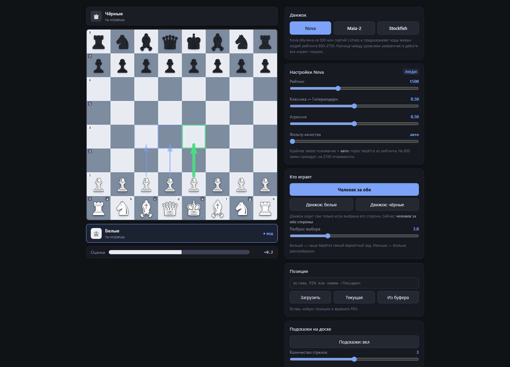

# Nova Chess

**Шахматный анализатор, который играет как человек — и не зевает.**

[]()
[]()
[]()



Три движка в одном интерфейсе: **Nova** и **Maia-2** предсказывают ходы живых
людей заданного рейтинга, **Stockfish** считает объективно лучший ход.
Фильтр качества отсеивает ходы, которые человек бы сделал, но которые
стоят материала.

---

## Проблема

Обычные движки ослабляют **случайными зевками**. Stockfish на «уровне 1200»
выдаёт гениальные ходы вперемешку с идиотскими — так люди не играют.

**Nova** обучена на **500 миллионах партий Lichess** и предсказывает именно
те ходы, которые выбирают люди. Но у неё нет оценки позиции: она не накажет
за грубый зевок.

**Решение:** человеческий движок предлагает ходы → Stockfish проверяет
качество → движок выбирает из тех, что и по-человечески, и не глупо.

---

## Возможности

| Функция | Описание |
|---|---|
| 🎭 **Три движка** | Nova (800–2700), Maia-2 (1100–1900), Stockfish |
| 📊 **Настройка рейтинга** | отдельная модель поведения для каждого уровня |
| 🎨 **Две оси стиля** | классика ↔ гипермодернизм, спокойствие ↔ агрессия |
| 🛡️ **Фильтр качества** | Stockfish отсеивает ходы, теряющие больше N сантипешек |
| 🎚️ **Калибровка по рейтингу** | порог фильтра выводится из рейтинга автоматически |
| ♟️ **Стрелки подсказок** | от 1 до 5 ходов прямо на доске, толщина = вероятность |
| ✨ **Плавная анимация** | фигуры переезжают, а не телепортируются |
| 📈 **Полоса оценки** | всегда с точки зрения белых, не скачет по знаку |
| ♟️ **CLI** | команды `moves`, `play`, `compare`, `selfplay` |
| ✅ **62 теста** | кодирование, движки, фильтр, гибрид, перспектива ходов |

---

## Установка

```bash
git clone https://github.com/n1lokaDeep/nova-chess.git
cd nova-chess
pip install -r requirements.txt
```

### Модели

**Nova** (381 МБ) — скачайте с Hugging Face:

```bash
curl -L -o models/nova_v3b.onnx \
  https://huggingface.co/novachess/novachess-engine/resolve/main/nova_v3b.onnx

curl -L -o models/nova_v3b.onnx.data \
  https://huggingface.co/novachess/novachess-engine/resolve/main/nova_v3b.onnx.data
```

**Stockfish** — с [stockfishchess.org/download](https://stockfishchess.org/download/),
путь укажите в переменной окружения:

```bash
export NOVA_STOCKFISH_PATH=/path/to/stockfish
```

**Maia-2** — ставится одним пакетом, веса подтянутся сами:

```bash
pip install maia2
```

---

## Использование

### Веб-интерфейс

```bash
python -m nova_chess.web.server
```

Откроется `http://127.0.0.1:8765/` — доска с выбором движка, ползунками
рейтинга и стрелками подсказок.

### CLI

```bash
# Какие ходы сделал бы человек рейтинга 1500?
python -m nova_chess.cli moves --rating 1500 --top 5

# Один ход движка с фильтром качества
python -m nova_chess.cli play --rating 1800 --strictness 0.7

# Сравнить чистую Nova и фильтрованную
python -m nova_chess.cli compare --stockfish /path/to/stockfish

# Партия Nova против Nova
python -m nova_chess.cli selfplay --moves 40 --rating 2000
```

Пример вывода:

```
$ python -m nova_chess.cli moves --rating 1500 --top 4
Позиция: rnbqkbnr/pppppppp/8/8/8/8/PPPPPPPP/RNBQKBNR w KQkq - 0 1
Ход белые
Рейтинг: 1500   Стиль: 0.50   Агрессия: 0.50

Ход         Nova   Stockfish   Оценка
----------------------------------------------
e2e4       56.0%         +32   лучший
d2d4       23.9%         +20   потеря 12 сп
c2c4        5.1%          +9   потеря 23 сп
g1f3        3.6%         +21   потеря 11 сп
```

### Python API

```python
import chess
from nova_chess.core import HumanLikeEngine

engine = HumanLikeEngine("models/nova_v3b.onnx", "stockfish/stockfish.exe")
board = chess.Board()

# Что сыграл бы человек 1500?
for mv in engine.human_moves(board, rating=1500, top=3):
    print(f"{mv.uci}  {mv.percent:.1f}%")

# Ход с контролем качества
move = engine.choose_move(board, rating=1500)
print(move.uci())

engine.close()
```

### Только Nova, без Stockfish

```python
from nova_chess.core import NovaEngine

nova = NovaEngine("models/nova_v3b.onnx")

# Вероятности всех легальных ходов
probs = nova.move_probabilities(chess.Board(), rating=1500)

# Сэмплировать ход как человек
move = nova.sample_move(chess.Board(), rating=1500, sharpness=3.0)
```

---

## Как это работает

### Кодирование позиции

Модель принимает тензор `(18, 8, 8)`:

| Плоскости | Содержимое |
|---|---|
| 0–5 | белые: пешка, конь, слон, ладья, ферзь, король |
| 6–11 | чёрные в том же порядке |
| 12 | чей ход |
| 13–16 | права рокировки: K, Q, k, q |
| 17 | поле взятия на проходе |

Плюс вектор условий `(rating_norm, classical, aggression)`.

### Пространство ходов

`64 × 64 = 4096` комбинаций «откуда-куда» плюс три блока превращений
(конь, слон, ладья) — итого **16384 индекса**. Превращение в ферзя
использует смещение 0 и восстанавливается по позиции.

### Каждый движок — со своей перспективы

Оценки Stockfish всегда приводятся к перспективе **того, кто ходит**, прежде
чем ходы ранжируются. Иначе при ходе чёрных порядок переворачивается и движок
начинает предлагать худший для них ход — отдавать фигуры бесплатно.

### Калибровка по рейтингу

Nova сама по себе слабо реагирует на рейтинг: авторы применяют отдельный
калибровочный слой, которого нет в открытом релизе. Здесь тот же эффект
достигается порогом качества:

| Рейтинг | Строгость | Допустимая потеря |
|---|---|---|
| 800 | 0.00 | 900 сп (зевки проходят) |
| 1200 | 0.29 | 427 сп |
| 1600 | 0.46 | 297 сп |
| 2000 | 0.62 | 205 сп |
| 2400 | 0.75 | 132 сп |
| 2700 | 0.85 | 84 сп (почти идеально) |

На 800 зевок вроде `Ng5` (потеря 727 сп) остаётся в списке ходов,
на 2400 и выше — отсеивается.

---

## Структура проекта

```
nova-chess/
├── nova_chess/
│   ├── core/
│   │   ├── encoding.py   # FEN → тензор, нормализация рейтинга
│   │   ├── engine.py     # обёртка над ONNX-моделью Nova
│   │   ├── filter.py     # фильтр качества + калибровка по рейтингу
│   │   ├── hybrid.py     # объединение Nova + Stockfish
│   │   └── maia.py       # обёртка над Maia-2
│   ├── web/
│   │   ├── server.py     # HTTP-сервер
│   │   └── ui.html       # интерфейс
│   └── cli.py            # командная строка
├── models/               # nova_v3b.onnx (не в git)
├── tests/                # 62 теста
├── scripts/              # вспомогательные проверки
└── docs/images/          # скриншоты
```

---

## Тесты

```bash
pytest tests/ -v
```

```
62 passed in 17.58s
```

Тесты, требующие модель или Stockfish, автоматически пропускаются,
если файлы не найдены.

---

## Ограничения

- **Nova и Maia-2 не считают варианты.** Это policy-сети: один проход,
  без поиска. Они не находят тактику в глубину.
- **Nova: рейтинг от 800, Maia-2: 1100–1900.** Вне этих диапазонов
  модели не обучены, ползунки ограничены.
- **Разница по рейтингу у Nova умеренная.** В дебюте все играют теорию,
  поэтому уровни сходятся. Заметнее всего разница в миттельшпиле.
- **Фильтр замедляет ход.** Каждый кандидат оценивается Stockfish —
  около 0.1 с на позицию при глубине 8.
- **Maia-2 работает медленнее** остальных: у неё две головы (policy + value).
- **Оценка позиции требует Stockfish.** Без него полоса оценки не считается.

---

## Благодарности

- **[Nova](https://novachess.ai)** — модель человеческих ходов
- **[Maia](https://maiachess.com)** — пионер направления human-like движков
- **[python-chess](https://python-chess.readthedocs.io)** — работа с шахматами
- **[Stockfish](https://stockfishchess.org)** — эталонный движок

---

## Лицензия

MIT — см. [LICENSE](LICENSE).

Модели Nova и Maia-2 распространяются отдельно их авторами;
веса скачиваются с Hugging Face и в репозиторий не входят.
